# pixelplotlib

**Scientific plots as 8-bit and 16-bit pixel art.**

pixelplotlib is a small plotting library with a matplotlib-like API. Every figure is
rendered on a low-resolution canvas with bitmap fonts, palettes from retro consoles,
ordered dithering and sprite markers, then upscaled with crisp nearest-neighbour pixels.
It depends only on [NumPy](https://numpy.org) and [Pillow](https://python-pillow.org).

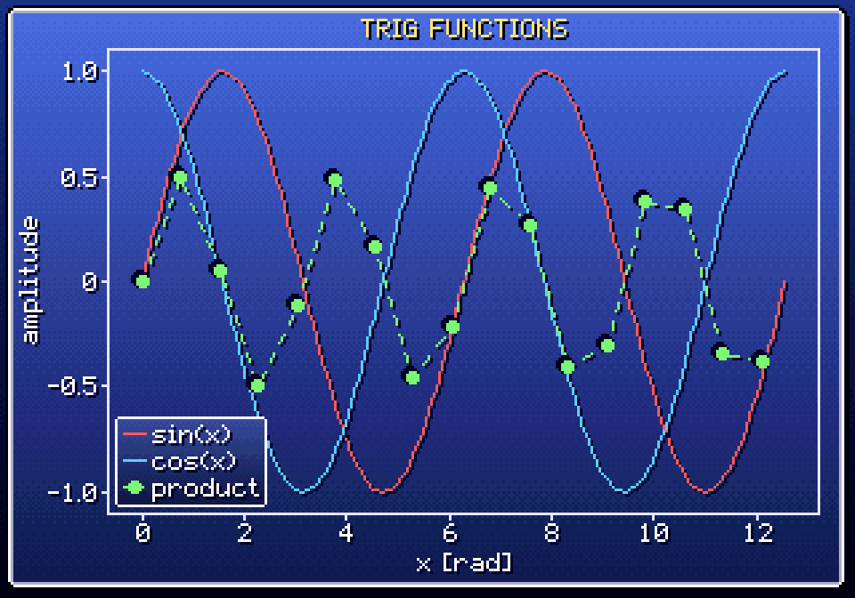

## Features

- **Familiar API**: `fig, ax = ppl.subplots()`, `ax.plot(...)`, `ax.set(...)`, `fig.save(...)`,
  plus a pyplot-style state machine (`ppl.plot`, `ppl.show`, ...).
- **Many plot types**: line, step, scatter, bar/barh, histograms (1-D and 2-D), fill_between,
  error bars, stem, imshow, pcolormesh, contour/contourf, quiver, pie, box, violin,
  annotations, reference lines/spans, log scales, colorbars, legends and subplot grids.
- **Retro styles**: `8bit` (NES), `16bit` (SNES-style 5-bit colour), `gameboy`, `pico8`,
  `c64`, `cga` and `1bit`, each with its own resolution, palette, fonts and decorations.
- **Pixel-art rendering**: bitmap fonts, Bayer dithering for gradients and transparency,
  palette-snapped colormaps, sprite markers (hearts, stars, skulls, UFOs, ...).
- **Output**: PNG (or any Pillow format) at integer scale, optional CRT scanlines, and
  animated GIFs.

## Installation

pixelplotlib is managed with [uv](https://docs.astral.sh/uv/). Add it to your project
straight from GitHub:

```bash
uv add git+https://github.com/ap--/pixelplotlib
```

or install it into the current environment with `uv pip install git+https://github.com/ap--/pixelplotlib`.
Python 3.10 or newer is required.

## Quick start

```python
import numpy as np
import pixelplotlib as ppl

x = np.linspace(0, 10, 200)
fig, ax = ppl.subplots(style="16bit")
ax.plot(x, np.sin(x), label="sin")
ax.plot(x, np.cos(x), label="cos")
ax.set(title="HELLO WAVES", xlabel="t", ylabel="A")
ax.legend()
fig.save("waves.png")            # upscaled by the style's default scale
fig.save("waves_crt.png", scale=4, scanlines=True)
```

The pyplot-style interface works too:

```python
import pixelplotlib.pyplot as plt   # or: import pixelplotlib as plt

plt.figure(style="gameboy")
plt.plot([1, 3, 2, 4])
plt.title("GB")
plt.savefig("gb.png")
plt.show()                          # inline in Jupyter, else the system image viewer
```

Figures can also be returned as data: `fig.to_array()` gives the native-resolution RGB
array and `fig.to_image(scale=...)` a `PIL.Image`.

## Styles

Pick a style per figure (`ppl.subplots(style="pico8")`), globally (`ppl.use("c64")`) or
temporarily (`with ppl.context("1bit"): ...`). The canvas size in the table is the
native resolution, which is upscaled when saving.

<!-- styles:start -->
<table>
<tr><td align="center">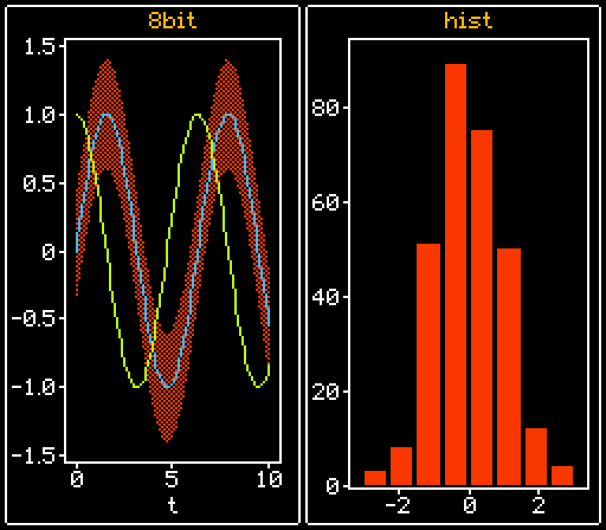<br><code>8bit</code> (256x224)</td><td align="center">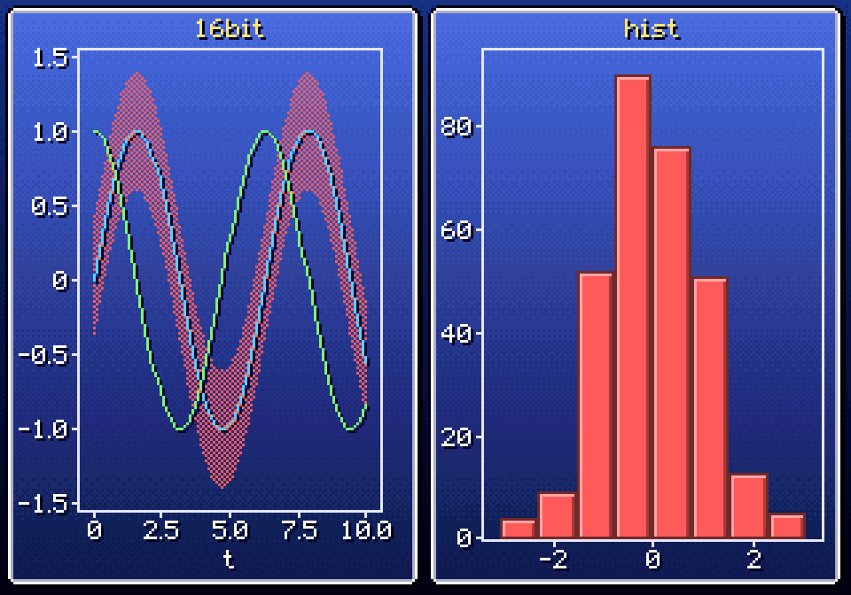<br><code>16bit</code> (320x224)</td></tr>
<tr><td align="center">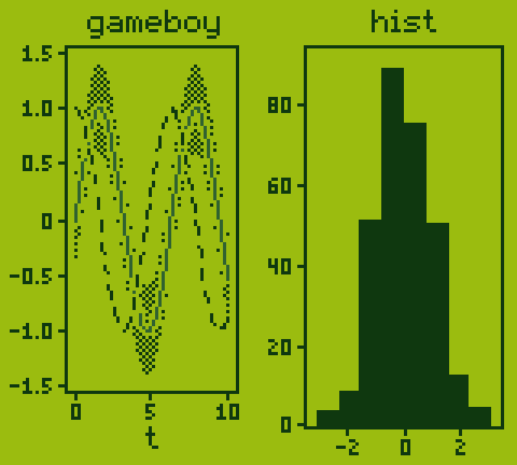<br><code>gameboy</code> (160x144)</td><td align="center">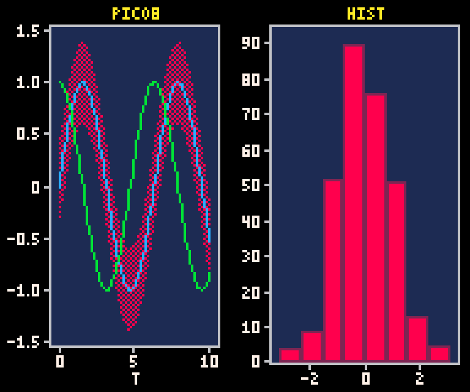<br><code>pico8</code> (192x160)</td></tr>
<tr><td align="center">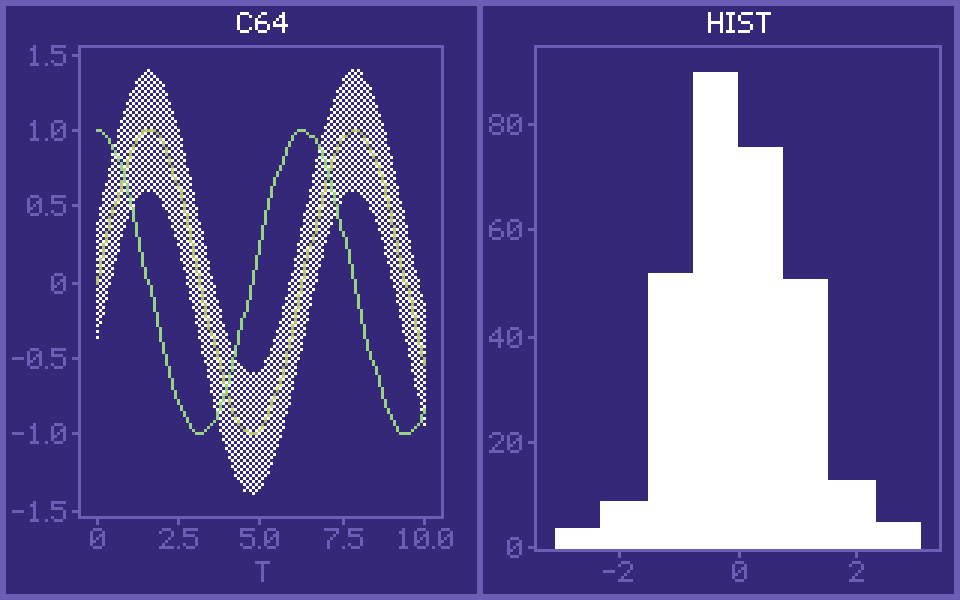<br><code>c64</code> (320x200)</td><td align="center">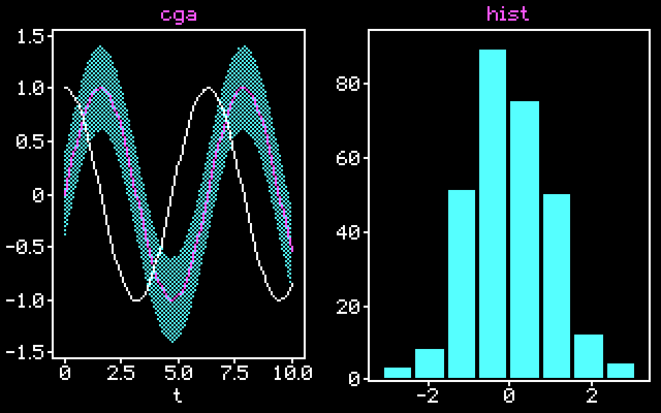<br><code>cga</code> (320x200)</td></tr>
<tr><td align="center">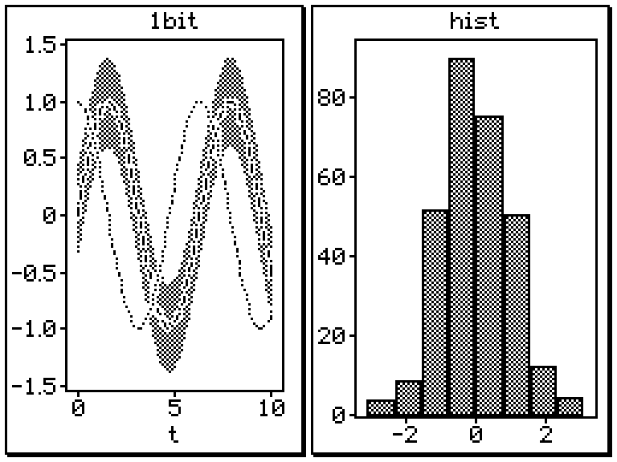<br><code>1bit</code> (256x192)</td></tr>
</table>

<details><summary>Code for the style demo</summary>

```python
rng = np.random.default_rng(0)
x = np.linspace(0, 10, 100)
fig, (ax1, ax2) = ppl.subplots(1, 2, style="16bit")
ax1.fill_between(x, np.sin(x) - 0.4, np.sin(x) + 0.4)
ax1.plot(x, np.sin(x), label="sin")
ax1.plot(x, np.cos(x), label="cos")
ax1.set(title=style, xlabel="t")
ax2.hist(rng.normal(size=300), bins=8)
ax2.set(title="hist")
```

</details>
<!-- styles:end -->

### Custom styles

Styles are dataclasses. Derive a new one with `Style.replace` and register it:

```python
neon = ppl.get_style("16bit").replace(
    name="neon",
    background="#000000",
    series=["#ff00ff", "#00ffff", "#ffff00"],
    cmap="plasma",
)
ppl.register(neon)
fig, ax = ppl.subplots(style="neon")
```

Useful fields include `size`, `scale`, `palette` (snap every colour to a fixed palette),
`bits` (bits per colour channel), `font`/`tick_font`, `line_width`, `line_shadow`,
`line_halo`, `bar_shading`, `panel` and `dither`.

## Plot types

Every image below was produced by the code shown next to it
(see [`examples/gallery.py`](examples/gallery.py)).

<!-- gallery:start -->
### Line plot


```python
x = np.linspace(0, 4 * np.pi, 200)
fig, ax = ppl.subplots(style="16bit")
ax.plot(x, np.sin(x), label="sin(x)")
ax.plot(x, np.cos(x), label="cos(x)")
ax.plot(x[::12], np.sin(x[::12]) * np.cos(x[::12]), "o--", label="product")
ax.set(title="TRIG FUNCTIONS", xlabel="x [rad]", ylabel="amplitude")
ax.legend(loc="lower left")
fig.save("line_plot.png")
```

### Scatter plot

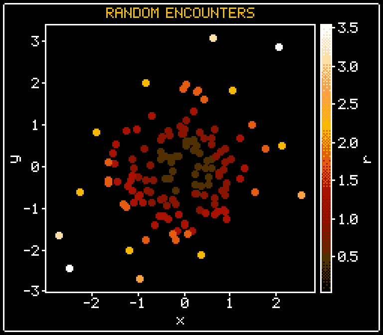

```python
rng = np.random.default_rng(1)
x, y = rng.normal(size=(2, 150))
fig, ax = ppl.subplots(style="8bit")
sc = ax.scatter(x, y, c=np.hypot(x, y), cmap="fire")
ax.set(title="RANDOM ENCOUNTERS", xlabel="x", ylabel="y")
ax.colorbar(sc, label="r")
fig.save("scatter_plot.png")
```

### Sprite markers

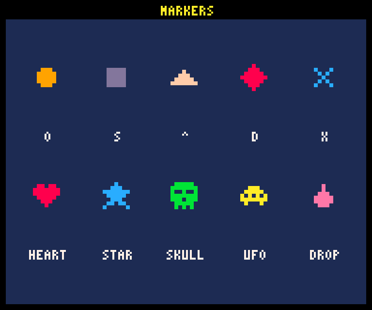

```python
fig, ax = ppl.subplots(style="pico8")
markers = ["heart", "star", "skull", "ufo", "drop", "o", "s", "^", "D", "x"]
for i, m in enumerate(markers):
    ax.scatter([i % 5], [i // 5], marker=m, size=2, color=f"C{i}")
    ax.text(i % 5, i // 5 - 0.45, m, ha="center", va="top")
ax.set(title="MARKERS", xlim=(-0.6, 4.6), ylim=(-0.9, 1.5))
ax.axis("off")
fig.save("sprite_markers.png")
```

### Bar chart

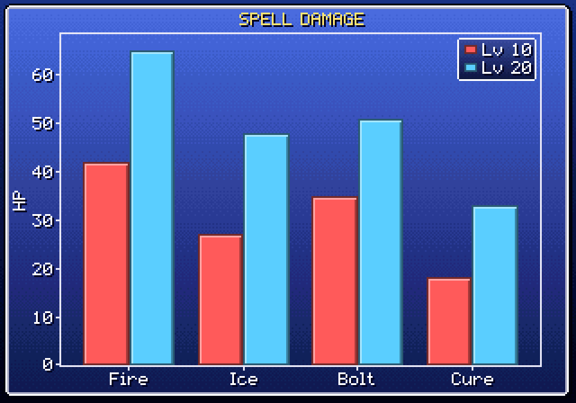

```python
labels = ["Fire", "Ice", "Bolt", "Cure"]
fig, ax = ppl.subplots(style="16bit")
x = np.arange(len(labels))
ax.bar(x - 0.2, [42, 27, 35, 18], width=0.4, label="Lv 10")
ax.bar(x + 0.2, [65, 48, 51, 33], width=0.4, label="Lv 20")
ax.set_xticks(x, labels)
ax.set(title="SPELL DAMAGE", ylabel="HP")
ax.legend(loc="upper right")
fig.save("bar_chart.png")
```

### Horizontal bars

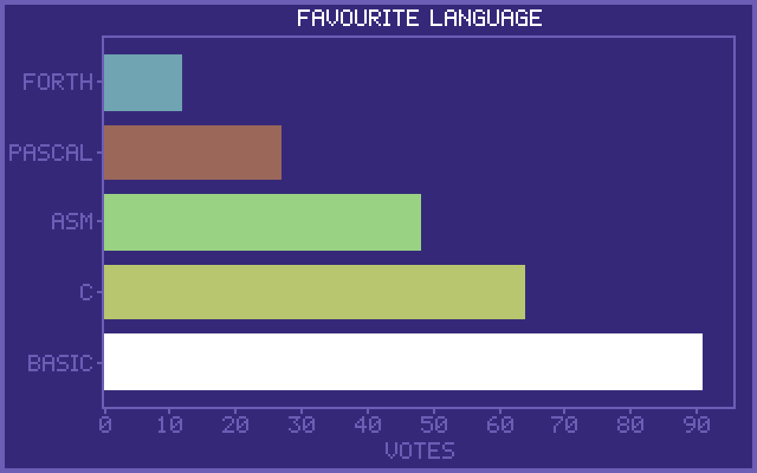

```python
fig, ax = ppl.subplots(style="c64")
langs = ["BASIC", "C", "ASM", "PASCAL", "FORTH"]
ax.barh(langs, [91, 64, 48, 27, 12], color=[f"C{i}" for i in range(5)])
ax.set(title="Favourite language", xlabel="votes")
fig.save("barh_chart.png")
```

### Histogram

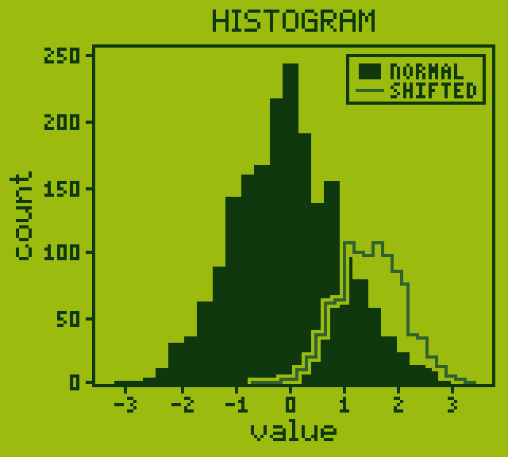

```python
rng = np.random.default_rng(7)
fig, ax = ppl.subplots(style="gameboy")
ax.hist(rng.normal(0, 1, 2000), bins=24, label="normal")
ax.hist(rng.normal(1.5, 0.6, 1000), bins=24, histtype="step", label="shifted")
ax.set(title="HISTOGRAM", xlabel="value", ylabel="count")
ax.legend()
fig.save("histogram.png")
```

### 2-D histogram

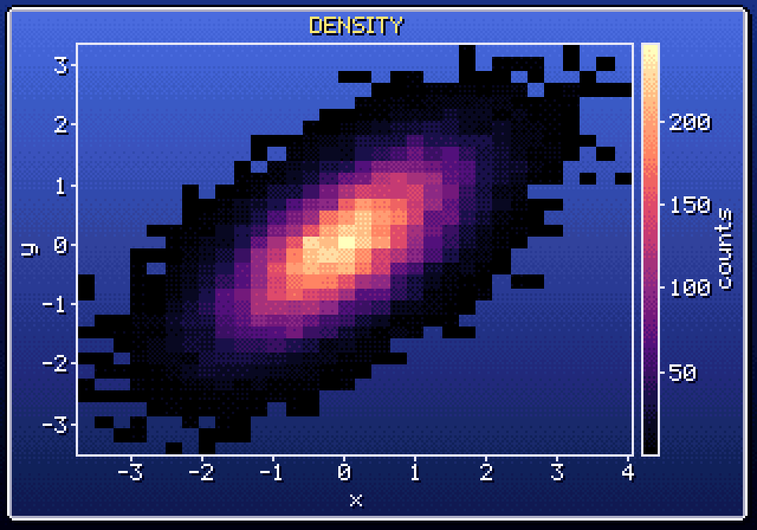

```python
rng = np.random.default_rng(3)
x = rng.normal(size=20000)
y = 0.6 * x + rng.normal(scale=0.7, size=20000)
fig, ax = ppl.subplots(style="16bit")
_, _, _, mesh = ax.hist2d(x, y, bins=32, cmap="magma")
ax.colorbar(mesh, label="counts")
ax.set(title="DENSITY", xlabel="x", ylabel="y")
fig.save("histogram_2d.png")
```

### Filled areas

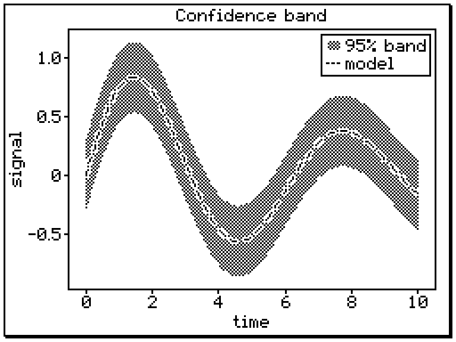

```python
x = np.linspace(0, 10, 120)
y = np.sin(x) * np.exp(-x / 8)
fig, ax = ppl.subplots(style="1bit")
ax.fill_between(x, y - 0.3, y + 0.3, label="95% band")
ax.plot(x, y, label="model")
ax.set(title="Confidence band", xlabel="time", ylabel="signal")
ax.legend()
fig.save("fill_between.png")
```

### Error bars

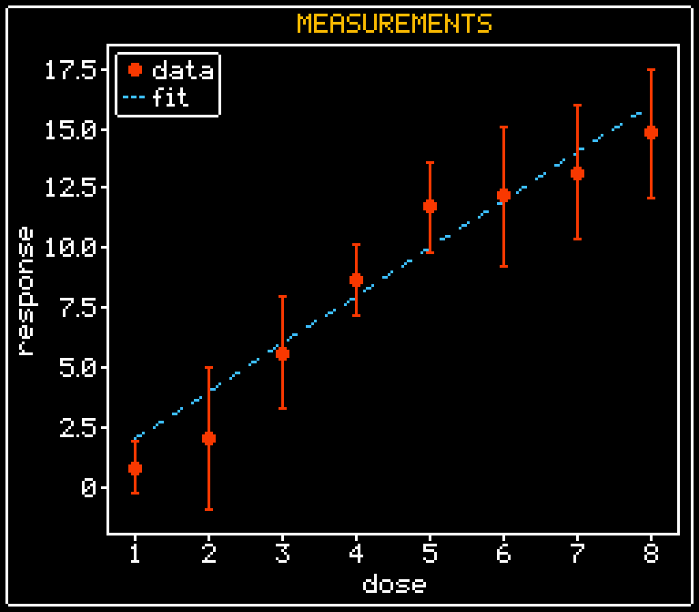

```python
rng = np.random.default_rng(5)
x = np.arange(1, 9)
y = 2.0 * x + rng.normal(0, 1.5, x.size)
fig, ax = ppl.subplots(style="8bit")
ax.errorbar(x, y, yerr=rng.uniform(1, 3, x.size), label="data")
ax.plot(x, 2.0 * x, "--", label="fit")
ax.set(title="MEASUREMENTS", xlabel="dose", ylabel="response")
ax.legend(loc="upper left")
fig.save("error_bars.png")
```

### Step and stem plots

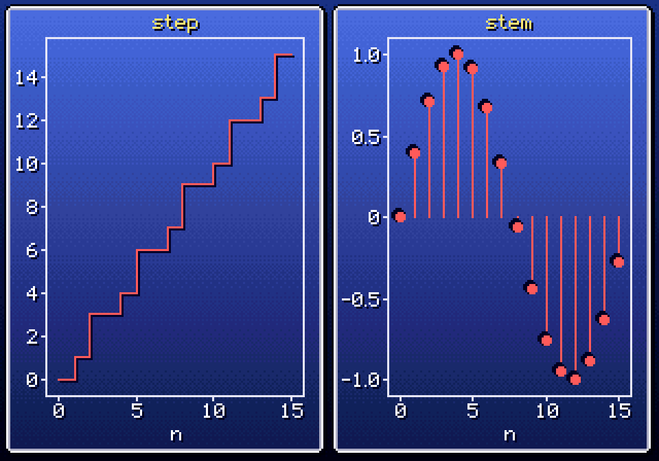

```python
n = np.arange(16)
fig, (ax1, ax2) = ppl.subplots(1, 2, style="snes")
ax1.step(n, np.cumsum(n % 3), where="post")
ax1.set(title="step", xlabel="n")
ax2.stem(n, np.sin(n / 2.5))
ax2.set(title="stem", xlabel="n")
fig.save("step_and_stem.png")
```

### Image / heatmap

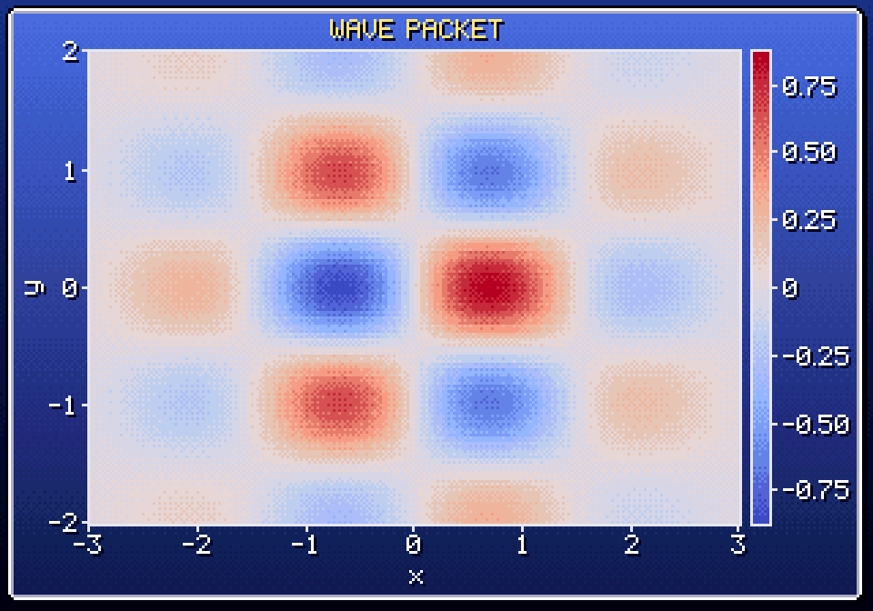

```python
y, x = np.mgrid[-2:2:64j, -3:3:96j]
z = np.sin(x * 2) * np.cos(y * 3) * np.exp(-(x**2 + y**2) / 4)
fig, ax = ppl.subplots(style="16bit")
im = ax.imshow(z, cmap="coolwarm", extent=(-3, 3, -2, 2), origin="lower")
ax.colorbar(im)
ax.set(title="WAVE PACKET", xlabel="x", ylabel="y")
fig.save("heatmap.png")
```

### Mandelbrot (imshow without dithering)

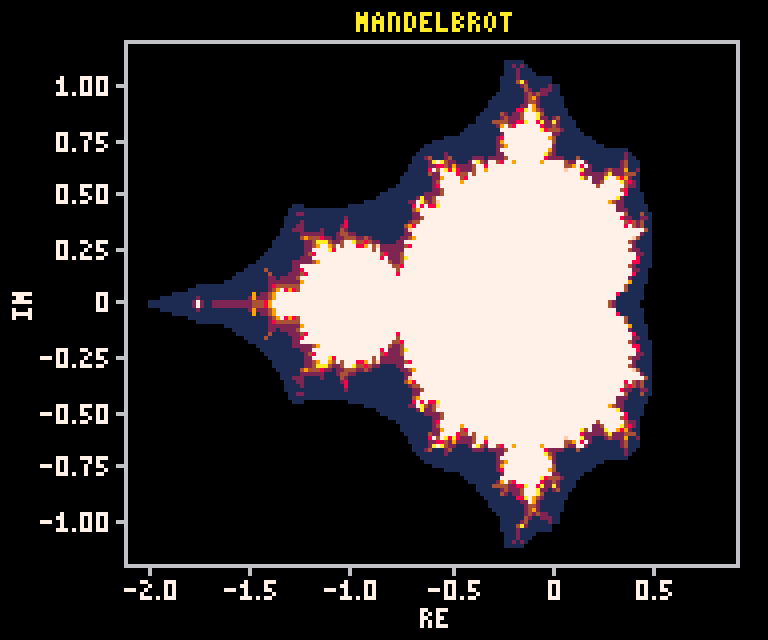

```python
y, x = np.mgrid[-1.2:1.2:150j, -2.1:0.9:200j]
c = x + 1j * y
z = np.zeros_like(c)
count = np.zeros(c.shape)
for _ in range(40):
    z = np.where(np.abs(z) < 4, z * z + c, z)
    count += np.abs(z) < 4
fig, ax = ppl.subplots(style="pico8")
ax.imshow(count, cmap="pico", dither=False, origin="lower", extent=(-2.1, 0.9, -1.2, 1.2))
ax.set(title="MANDELBROT", xlabel="Re", ylabel="Im")
fig.save("mandelbrot.png")
```

### Pixelated RGB image

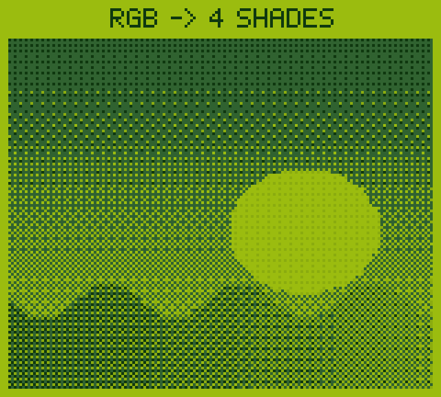

```python
y, x = np.mgrid[0:1:96j, 0:1:128j]
sky = np.stack([40 + 120 * y, 60 + 140 * y, 200 - 60 * y], axis=-1)
sun = np.hypot(x - 0.7, y - 0.55) < 0.18
sky[sun] = (255, 200, 60)
ground = y > 0.75 + 0.05 * np.sin(x * 20)
sky[ground] = np.stack([30 + 20 * x, 120 + 60 * x, 40 + 0 * x], axis=-1)[ground]
fig, ax = ppl.subplots(style="gameboy")
ax.imshow(sky.astype(np.uint8))
ax.set(title="RGB -> 4 SHADES")
ax.axis("off")
fig.save("rgb_image.png")
```

### Pcolormesh (irregular grid)

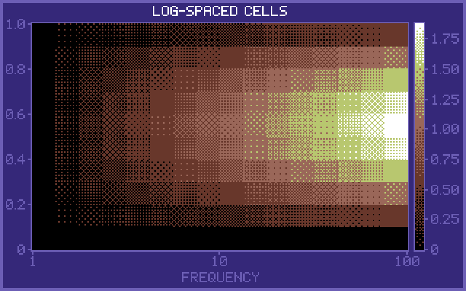

```python
xe = np.geomspace(1, 100, 17)
ye = np.linspace(0, 1, 11)
c = np.log10(xe[:-1])[None, :] * np.sin(np.pi * ye[:-1])[:, None]
fig, ax = ppl.subplots(style="c64")
mesh = ax.pcolormesh(xe, ye, c, cmap="fire")
ax.set_xscale("log")
ax.colorbar(mesh)
ax.set(title="Log-spaced cells", xlabel="frequency")
fig.save("pcolormesh.png")
```

### Contour lines

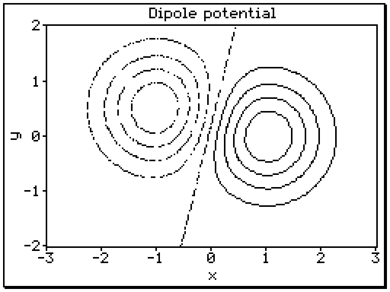

```python
y, x = np.mgrid[-2:2:80j, -3:3:120j]
z = np.exp(-((x - 1) ** 2 + y**2)) - np.exp(-((x + 1) ** 2 + (y - 0.5) ** 2))
fig, ax = ppl.subplots(style="1bit")
ax.contour(x, y, z, levels=10, colors="fg")
ax.set(title="Dipole potential", xlabel="x", ylabel="y")
fig.save("contour_lines.png")
```

### Filled contours

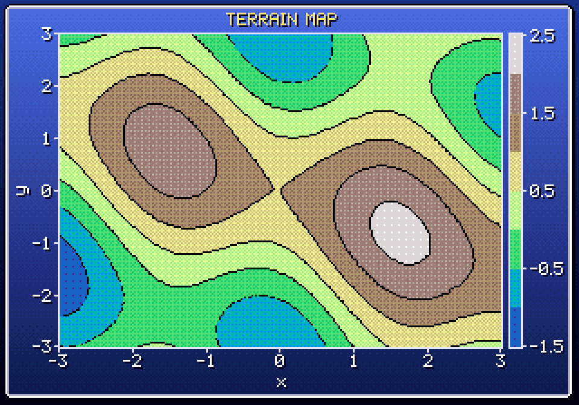

```python
y, x = np.mgrid[-3:3:90j, -3:3:120j]
z = np.sin(x) ** 2 + np.cos(y + x / 2) + 0.1 * x
fig, ax = ppl.subplots(style="16bit")
cs = ax.contourf(x, y, z, levels=8, cmap="terrain")
ax.contour(x, y, z, levels=8, colors="#000000")
ax.colorbar(cs)
ax.set(title="TERRAIN MAP", xlabel="x", ylabel="y")
fig.save("filled_contours.png")
```

### Vector field (quiver)

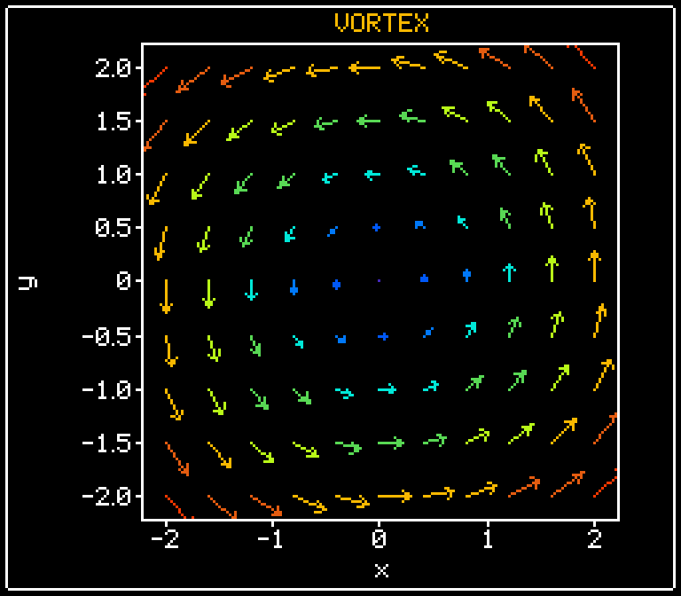

```python
y, x = np.mgrid[-2:2:9j, -2:2:11j]
u, v = -y, x
fig, ax = ppl.subplots(style="8bit")
ax.quiver(x, y, u, v, C=np.hypot(u, v), cmap="rainbow")
ax.set(title="VORTEX", xlabel="x", ylabel="y")
ax.set_aspect("equal")
fig.save("quiver.png")
```

### Pie chart

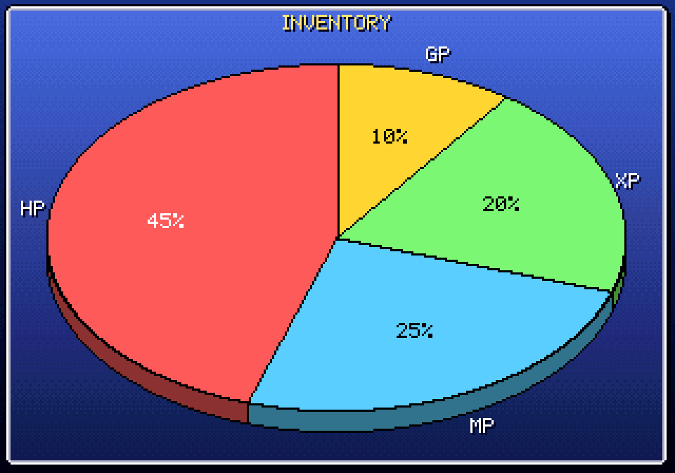

```python
fig, ax = ppl.subplots(style="16bit")
ax.pie([45, 25, 20, 10], labels=["HP", "MP", "XP", "GP"], autopct="%d%%")
ax.set_title("INVENTORY")
fig.save("pie_chart.png")
```

### Box plot

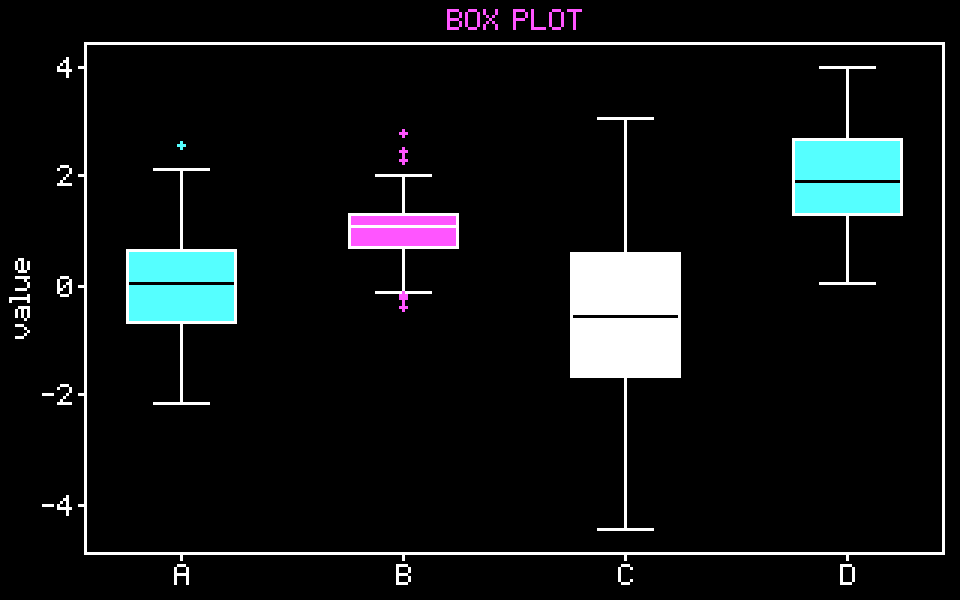

```python
rng = np.random.default_rng(11)
data = [rng.normal(mu, sd, 200) for mu, sd in [(0, 1), (1, 0.5), (-0.5, 1.5), (2, 0.8)]]
fig, ax = ppl.subplots(style="cga")
ax.boxplot(data, labels=["A", "B", "C", "D"])
ax.set(title="BOX PLOT", ylabel="value")
fig.save("box_plot.png")
```

### Violin plot

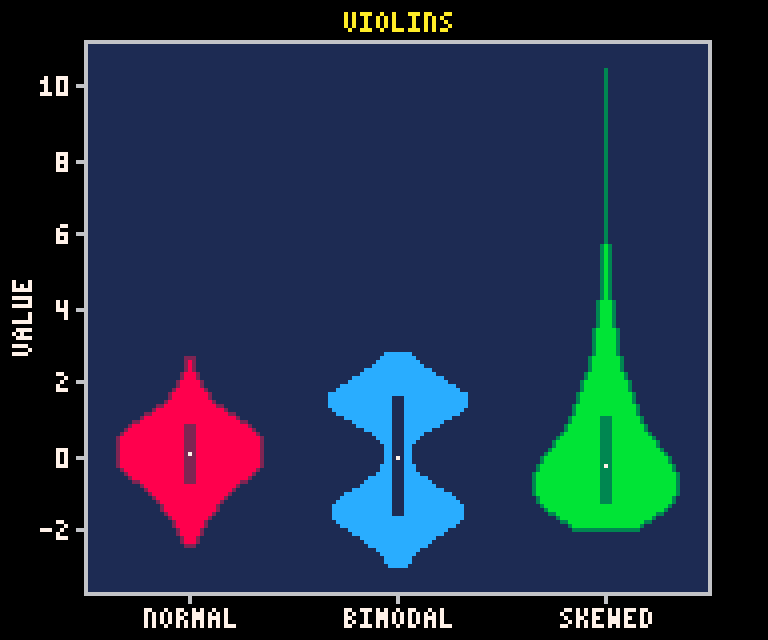

```python
rng = np.random.default_rng(12)
data = [rng.normal(0, 1, 300), np.concatenate([rng.normal(-1.5, 0.5, 150),
        rng.normal(1.5, 0.5, 150)]), rng.gamma(2, 1, 300) - 2]
fig, ax = ppl.subplots(style="pico8")
ax.violinplot(data, labels=["normal", "bimodal", "skewed"])
ax.set(title="VIOLINS", ylabel="value")
fig.save("violin_plot.png")
```

### Log scales

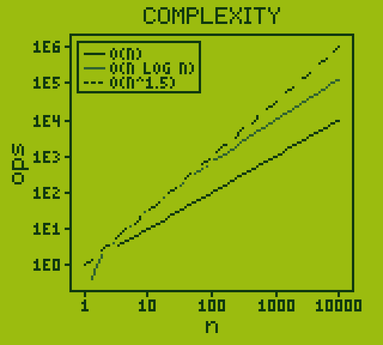

```python
n = np.geomspace(1, 1e4, 40)
fig, ax = ppl.subplots(style="gameboy")
ax.plot(n, n, label="O(n)")
ax.plot(n, n * np.log2(n), label="O(n log n)")
ax.plot(n, n**1.5, label="O(n^1.5)")
ax.set(xscale="log", yscale="log", title="COMPLEXITY", xlabel="n", ylabel="ops")
ax.legend(loc="upper left")
fig.save("log_scales.png")
```

### Annotations, reference lines and spans

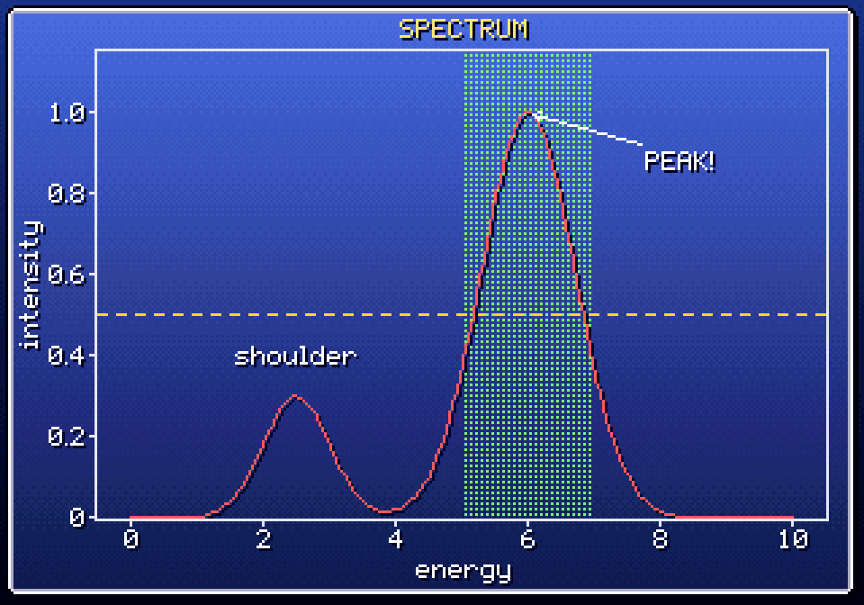

```python
x = np.linspace(0, 10, 200)
y = np.exp(-((x - 6) ** 2)) + 0.3 * np.exp(-((x - 2.5) ** 2) / 0.5)
fig, ax = ppl.subplots(style="16bit")
ax.axvspan(5, 7, color="C2", alpha=0.25)
ax.axhline(0.5, color="C3", linestyle="--")
ax.plot(x, y)
ax.annotate("PEAK!", xy=(6, 1.0), xytext=(8.3, 0.85))
ax.text(2.5, 0.38, "shoulder", ha="center")
ax.set(title="SPECTRUM", xlabel="energy", ylabel="intensity", ylim=(0, 1.15))
fig.save("annotations.png")
```

### Subplot grid

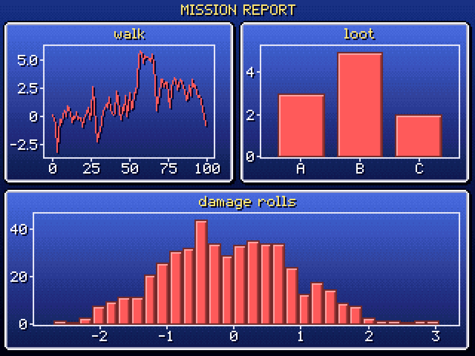

```python
rng = np.random.default_rng(2)
fig = ppl.Figure(size=(320, 240), style="16bit")
fig.suptitle("MISSION REPORT")
ax1 = fig.add_subplot(2, 2, 1)
ax1.plot(np.cumsum(rng.normal(size=100)))
ax1.set_title("walk")
ax2 = fig.add_subplot(2, 2, 2)
ax2.bar(["A", "B", "C"], [3, 5, 2])
ax2.set_title("loot")
ax3 = fig.add_subplot(2, 2, (3, 4))
ax3.hist(rng.normal(size=500), bins=30)
ax3.set_title("damage rolls")
fig.save("subplot_grid.png")
```

### Animated GIF

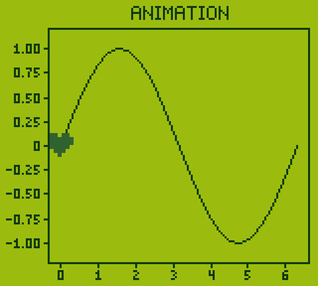

```python
x = np.linspace(0, 2 * np.pi, 120)

def frame(i):
    fig, ax = ppl.subplots(style="gameboy")
    ax.plot(x, np.sin(x + i * np.pi / 8))
    ax.scatter([x[i * 6]], [np.sin(x[i * 6] + i * np.pi / 8)], marker="heart", size=2)
    ax.set(title="ANIMATION", ylim=(-1.2, 1.2))
    return fig

ppl.animate(frame, 16, "docs/images/animation.gif", fps=8)
```
<!-- gallery:end -->

## Colormaps, palettes, fonts and sprites

- **Colormaps**: `viridis`, `magma`, `inferno`, `plasma`, `coolwarm`, `gray`, `fire`, `ice`,
  `ocean`, `terrain`, `rainbow`, `gameboy` and `pico`. Colormaps are quantised to
  `Style.cmap_levels` steps and snapped to the style's palette. Register your own with
  `ppl.register_cmap(ppl.Colormap(...))`, or pass any list of colours as `cmap=`.
- **Palettes** (`ppl.palettes`): `NES`, `PICO8`, `C64`, `CGA`, `GAMEBOY` and `ONE_BIT`.
- **Fonts**: `ppl.FONT_5X7` (mixed case) and `ppl.FONT_3X5` (tiny, upper case).
- **Markers** (`ppl.MARKERS`): `o`, `s`, `^`, `v`, `D`, `x`, `+`, `*`, `.`, `p`, plus the sprites
  `heart`, `star`, `skull`, `ufo` and `drop`. Use `size=2` or more to scale a sprite.
- **`ppl.pixelate(image, palette=..., size=..., dither=True)`** turns any RGB array into
  pixel art.

## Development

```bash
uv sync                                  # create .venv with the package and dev tools
uv run pytest                            # run the test suite
uv run ruff check                        # lint
uv build                                 # build the sdist and wheel into dist/
uv run python examples/gallery.py        # re-render docs/images and the README gallery
```

`examples/gallery.py` is the single source of truth for the images and snippets in this
README. Add a function decorated with `@example("Title")` and re-run it to extend the
gallery. Pass example names to render only those, or `--no-readme` to leave this file
untouched.
